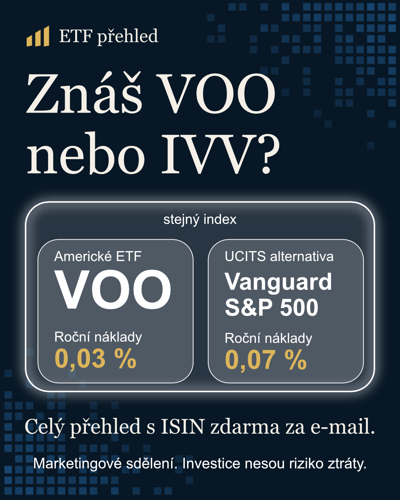
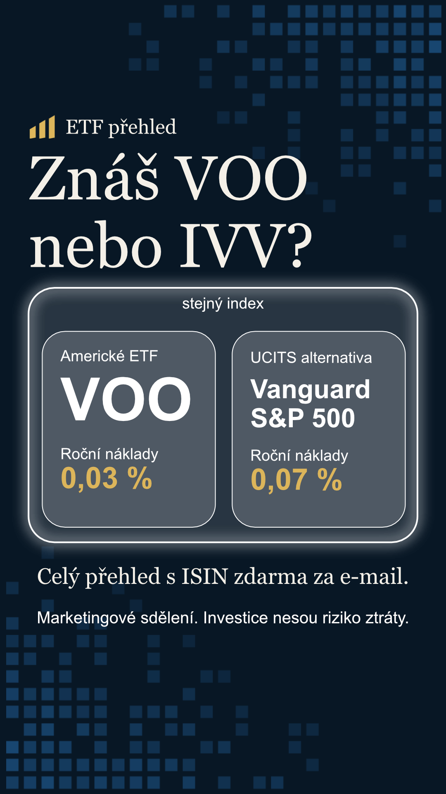

# Reklama A: hák "znáš VOO?" (v3)

Stav: texty a vizuály hotové (v3, po auditu 1; vizuály vytvořil Jan), podle pravidel Meta k 10. 10. 2026 spustitelné bez certifikace inzerenta (viz `compliance/checklist.md`) **po kontrole vizuálu v náhledu Ads Manageru** (okraje 9:16, čitelnost upozornění).

- **Platforma a formát (předběžně):** Meta (Facebook, Instagram), jeden obrázek 1080×1350 a varianta 9:16, mobil
- **Headline:** Znáš VOO nebo IVV? Porovnej náklady
- **Hlavní text:** Známá americká ETF mají UCITS alternativy na stejný index. Srovnali jsme 4 z nich: zaměření, roční náklady a co si ověřit u brokera. Srovnání hned, celý přehled s ISIN zdarma za e-mail. Marketingové sdělení, ne investiční doporučení. Investice nesou riziko ztráty.
- **Popis:** Marketingové sdělení, ne investiční doporučení. Investice nesou riziko ztráty. (upozornění je i v hlavním textu a ve vizuálu, protože Popis se ve všech umístěních nezobrazuje)
- **Tlačítko (CTA):** Další informace
- **Vizuál / koncept:** dvě karty vedle sebe: vlevo americké ETF (ticker, roční náklady), vpravo UCITS alternativa na stejný index (roční náklady), mezi nimi "stejný index". Bez grafů výkonnosti a bez slibů výnosů. Ve vizuálu čitelně: "Marketingové sdělení. Investice nesou riziko ztráty."
- **Cílení:** ČR, čeština, 18+; zájmy finance a investování jen pokud to platforma dovolí, jinak široké cílení, publikum vybírá kreativa
- **UTM:** `?utm_source=meta&utm_medium=paid_social&utm_campaign=etf_prehled&utm_content=ad_a` (cíl: https://clientelo-zadani-b.vercel.app/)
- **Návaznost na první obrazovku:** obě reklamy vedou na stejnou stránku s nadpisem "Evropské alternativy amerických ETF" (štítek "Srovnání"). Měření pozná reklamu podle `utm_content=ad_a` (varianta "a").

## Vizuál

Upozornění na riziko je přímo v obrázku. U 9:16 leží obsah mimo horních 250 px a dolních 350 px (přibližná rezerva pro rozhraní, ověřit v náhledu). Obrázek nemá falešné tlačítko, klikací je tlačítko Mety ("Další informace"). Čísla v obrázku odpovídají `data/etf.json`.
